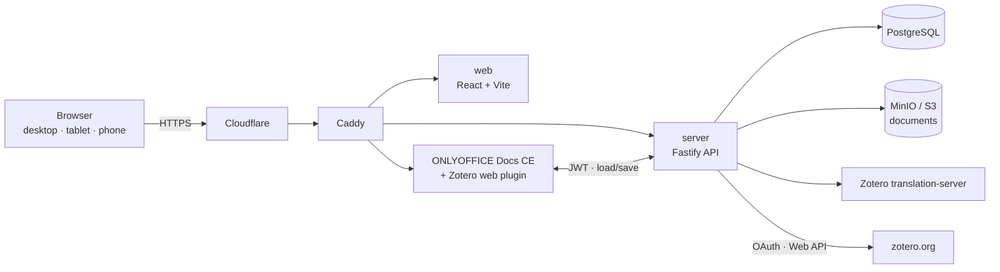

<p align="center">🇬🇧 English | <a href="README.tr.md">🇹🇷 Türkçe</a></p>

# CiteDocs

**Write your papers with Zotero citations from any device with a browser — even if you don't have a laptop.**

🌐 **Live:** https://docs.sifirdanbire.com.tr · Free · Open source (AGPL-3.0)

CiteDocs is a free web app for students: a Word / Google Docs–style editor and Zotero in one place. It runs entirely in the browser. You don't need to install Zotero desktop or Microsoft Word.

## Why CiteDocs?

Many students don't own a laptop. They write assignments on a tablet or phone. Today, citing with Zotero still needs a desktop computer:

- Zotero's **Word and LibreOffice plugins** run only with the Zotero desktop app.
- Zotero's **Google Docs integration** needs the Zotero Connector browser extension *and* the Zotero desktop app ([Zotero docs](https://www.zotero.org/support/google_docs)), so it works only on a computer.
- On phones and tablets there is no real way to add Zotero citations and a bibliography to a document.

CiteDocs moves the whole workflow into the browser. You write, connect your zotero.org library, insert citations and build a bibliography on one web page. Because it's browser-based, it opens on tablets and phones too. Mobile support is a core goal; see [Known limitations](#known-limitations). CiteDocs is free and open source, so the gap between students with laptops and students without them gets a little smaller.

## Features

- **Full document editor** — ONLYOFFICE Docs Community Edition 10, with a Word-like interface (Collabora Online kept as a fallback behind a feature flag).
- **Official Zotero web plugin** inside the editor. Connect with **zotero.org OAuth**; no API key needed.
- **Add sources** by DOI, ISBN, PMID or URL (via Zotero `translation-server`); **import** BibTeX, RIS and CSL-JSON.
- **All CSL styles** — APA 7 by default; IEEE, Chicago and thousands more. Switch styles in place and refresh every citation.
- **Compatible citations** — documents are `.docx` with Zotero field codes, so you can keep working in Word or LibreOffice with the Zotero desktop plugin.
- **Autosave** and a **fully Turkish interface**.

## How to use (for students)

1. Open https://docs.sifirdanbire.com.tr and **sign up** with your email.
2. **Create a new document** (or upload a `.docx`).
3. Click the **Zotero** button and **connect your zotero.org account** (one-click OAuth). No zotero.org account yet? Create one for free at zotero.org.
4. **Add sources** — paste a DOI/ISBN/PMID/URL, or import a BibTeX/RIS file.
5. **Insert citations** where you need them, then insert the **bibliography**. Pick a style (APA 7, IEEE, …); changing it later updates everything. Download as `.docx` when you're done.

## Architecture



TypeScript monorepo (pnpm):

| Path | What it is |
|---|---|
| `apps/web` | Vite + React frontend |
| `apps/server` | Fastify REST API, auth, document storage, ONLYOFFICE callbacks, Zotero proxy |
| `packages/csl-engine` | `citeproc-js` wrapper and CSL style registry |
| `packages/zotero-core` | translation-server client and Zotero Web API sync |
| `packages/docx-exporter` | DOCX export with Zotero field codes |
| `packages/shared`, `editor`, `pdf-reader`, `collabora-cite` | shared types, legacy TipTap editor, PDF reader, Collabora integration |
| `deploy/` | production Compose files, Caddyfiles, ONLYOFFICE image, backups |

Production runs on AWS (eu-central-1) with Docker Compose (caddy, server, web, postgres, minio, translation-server, onlyoffice) behind Cloudflare, with nightly S3 backups. More detail: [ARCHITECTURE.md](ARCHITECTURE.md), [docs/ADR-001-integration.md](docs/ADR-001-integration.md).

## Self-hosting

Short version (Docker + a domain):

```bash
git clone https://github.com/zedraxa/citedocs.git && cd citedocs
# create deploy/.env with PUBLIC_HOST, POSTGRES_PASSWORD, MINIO_ROOT_USER,
# MINIO_ROOT_PASSWORD, ENCRYPTION_KEY, ONLYOFFICE_JWT_SECRET (+ optional Zotero OAuth keys)
docker compose --env-file deploy/.env -f deploy/docker-compose.prod.onlyoffice.yml up -d --build
```

Full guide: [docs/SELF-HOSTING.md](docs/SELF-HOSTING.md).

## Development and tests

Requirements: Node.js 22, pnpm (`corepack enable`), Docker.

```bash
pnpm install
cp .env.example .env
docker compose up -d postgres minio translation-server   # local services
pnpm dev            # server + web
pnpm lint && pnpm typecheck && pnpm build
pnpm test           # Vitest unit/integration tests
pnpm test:e2e       # Playwright (BASE_URL defaults to http://localhost:5173)
```

## Known limitations

- **Mobile / tablet:** CiteDocs opens in mobile browsers because it is web-based, but phones and tablets have **not been officially tested yet**. Mobile testing is in progress, and feedback is very welcome: please [open an issue](https://github.com/zedraxa/citedocs/issues) with your device and browser.
- **ONLYOFFICE Docs CE** allows at most **20 simultaneous editors** per server.
- You need a (free) zotero.org account to use your Zotero library.

## Contributing

Contributions, bug reports and translations are welcome. See [CONTRIBUTING.md](CONTRIBUTING.md).

## License

[GNU AGPL-3.0](LICENSE). If you run a modified version as a public service, you must share your source code.

## Acknowledgements

CiteDocs is built on great open-source work:
[Zotero](https://www.zotero.org/) (web library, translation-server, ONLYOFFICE Zotero plugin, PDF reader),
[ONLYOFFICE Docs](https://github.com/ONLYOFFICE/DocumentServer),
[citeproc-js](https://github.com/Juris-M/citeproc-js) and the [CSL style repository](https://github.com/citation-style-language/styles),
[Collabora Online](https://www.collaboraonline.com/),
Fastify, React, Vite, PostgreSQL, MinIO and Caddy.
