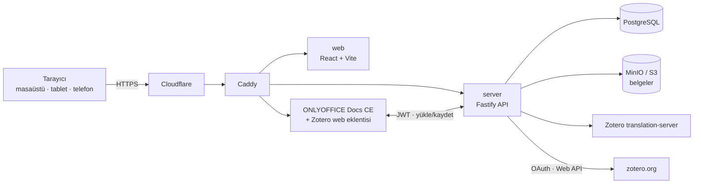

<p align="center"><a href="README.md">🇬🇧 English</a> | 🇹🇷 Türkçe</p>

# CiteDocs

**Ödevini ve makaleni, tarayıcısı olan her cihazdan Zotero atıflarıyla yaz — laptopun olmasa bile.**

🌐 **Canlı:** https://docs.sifirdanbire.com.tr · Ücretsiz · Açık kaynak (AGPL-3.0)

CiteDocs öğrenciler için ücretsiz bir web uygulamasıdır: Word / Google Docs benzeri bir editör ve Zotero bir arada. Tamamen tarayıcıda çalışır; masaüstü Zotero ya da Microsoft Word kurmanız gerekmez.

## Neden CiteDocs?

Pek çok öğrencinin laptopu yok; ödevlerini tablet ya da telefondan yazıyorlar. Oysa Zotero ile atıf yapmak bugün hâlâ masaüstü bilgisayar gerektiriyor:

- Zotero'nun **Word ve LibreOffice eklentileri** yalnızca masaüstü Zotero uygulamasıyla çalışır.
- Zotero'nun **Google Docs entegrasyonu**, Zotero Connector tarayıcı eklentisine *ve* masaüstü Zotero uygulamasına ihtiyaç duyar ([Zotero belgeleri](https://www.zotero.org/support/google_docs)); yani yalnızca bilgisayarda çalışır.
- Telefon ve tablette bir belgeye Zotero atıfı ve kaynakça eklemenin gerçek bir yolu yok.

CiteDocs bu iş akışının tamamını tarayıcıya taşır: yazarsınız, zotero.org kütüphanenizi bağlarsınız, atıf ve kaynakçayı aynı sayfada eklersiniz. Tarayıcı tabanlı olduğu için tablet ve telefonda da açılır; mobil destek projenin temel hedefidir (bkz. [Bilinen sınırlar](#bilinen-sınırlar)). Ücretsiz ve açık kaynak olduğu için laptopu olan ve olmayan öğrenciler arasındaki eşitsizliği biraz olsun azaltır.

## Özellikler

- **Tam belge editörü** — Word benzeri arayüzüyle ONLYOFFICE Docs Community Edition 10 (Collabora Online, özellik bayrağı arkasında yedek olarak duruyor).
- Editörün içinde **resmi Zotero web eklentisi**; **zotero.org OAuth** ile bağlanma, API anahtarı gerekmez.
- DOI, ISBN, PMID veya URL ile **kaynak ekleme** (Zotero `translation-server`); BibTeX, RIS ve CSL-JSON **içe aktarma**.
- **Tüm CSL stilleri** — varsayılan APA 7; IEEE, Chicago ve binlercesi. Stili yerinde değiştirip tüm atıfları yenileme.
- **Uyumlu atıflar** — belgeler Zotero alan kodlarıyla `.docx`; Word veya LibreOffice'te Zotero masaüstü eklentisiyle çalışmaya devam edebilirsiniz.
- **Otomatik kayıt** ve **tamamen Türkçe arayüz**.

## Nasıl kullanılır? (öğrenciler için)

1. https://docs.sifirdanbire.com.tr adresini açın ve e-postanızla **kayıt olun**.
2. **Yeni belge oluşturun** (veya bir `.docx` yükleyin).
3. **Zotero** düğmesine tıklayıp **zotero.org hesabınızı bağlayın** (tek tıkla OAuth). Hesabınız yoksa zotero.org'dan ücretsiz açabilirsiniz.
4. **Kaynak ekleyin** — DOI/ISBN/PMID/URL yapıştırın ya da BibTeX/RIS dosyası içe aktarın.
5. Gereken yerlere **atıf ekleyin**, ardından **kaynakçayı** ekleyin. Stil seçin (APA 7, IEEE, …); sonradan değiştirirseniz her şey güncellenir. Bitince `.docx` olarak indirin.

## Mimari



pnpm ile yönetilen TypeScript monorepo: `apps/web` (Vite + React), `apps/server` (Fastify API, kimlik doğrulama, belge depolama, ONLYOFFICE geri çağrıları, Zotero proxy), `packages/csl-engine` (`citeproc-js` + CSL stilleri), `packages/zotero-core` (translation-server istemcisi, Zotero Web API senkronu), `packages/docx-exporter` (Zotero alan kodlu DOCX), `deploy/` (üretim Compose dosyaları, Caddy, ONLYOFFICE imajı, yedekler).

Üretim ortamı AWS eu-central-1 üzerinde, Cloudflare arkasında Docker Compose ile çalışır (caddy, server, web, postgres, minio, translation-server, onlyoffice); her gece S3'e yedek alınır. Ayrıntılar: [ARCHITECTURE.md](ARCHITECTURE.md), [docs/ADR-001-integration.md](docs/ADR-001-integration.md).

## Kendi sunucunda çalıştır

Kısa hali (Docker + bir alan adı):

```bash
git clone https://github.com/zedraxa/citedocs.git && cd citedocs
# deploy/.env dosyasına PUBLIC_HOST, POSTGRES_PASSWORD, MINIO_ROOT_USER,
# MINIO_ROOT_PASSWORD, ENCRYPTION_KEY, ONLYOFFICE_JWT_SECRET (+ isteğe bağlı Zotero OAuth) yazın
docker compose --env-file deploy/.env -f deploy/docker-compose.prod.onlyoffice.yml up -d --build
```

Tam rehber: [docs/SELF-HOSTING.tr.md](docs/SELF-HOSTING.tr.md).

## Geliştirme ve testler

Gereksinimler: Node.js 22, pnpm (`corepack enable`), Docker.

```bash
pnpm install
cp .env.example .env
docker compose up -d postgres minio translation-server   # yerel servisler
pnpm dev            # server + web
pnpm lint && pnpm typecheck && pnpm build
pnpm test           # Vitest birim/entegrasyon testleri
pnpm test:e2e       # Playwright (BASE_URL varsayılanı http://localhost:5173)
```

## Bilinen sınırlar

- **Mobil / tablet:** CiteDocs web tabanlı olduğu için mobil tarayıcılarda açılır, ancak telefon ve tabletlerde **henüz resmi olarak test edilmedi**. Mobil testler sürüyor; geri bildiriminizi bekliyoruz. Cihazınızı ve tarayıcınızı belirterek [issue açabilirsiniz](https://github.com/zedraxa/citedocs/issues).
- **ONLYOFFICE Docs CE** sunucu başına aynı anda en fazla **20 editöre** izin verir.
- Zotero kütüphanenizi kullanmak için (ücretsiz) bir zotero.org hesabı gerekir.

## Katkı

Katkılar, hata bildirimleri ve çeviriler memnuniyetle karşılanır. Bkz. [CONTRIBUTING.md](CONTRIBUTING.md).

## Lisans

[GNU AGPL-3.0](LICENSE). Değiştirilmiş bir sürümü herkese açık bir hizmet olarak çalıştırırsanız kaynak kodunuzu paylaşmanız gerekir.

## Teşekkür

CiteDocs şu açık kaynak projelerin üzerine kuruludur:
[Zotero](https://www.zotero.org/) (web kütüphanesi, translation-server, ONLYOFFICE Zotero eklentisi, PDF okuyucu),
[ONLYOFFICE Docs](https://github.com/ONLYOFFICE/DocumentServer),
[citeproc-js](https://github.com/Juris-M/citeproc-js) ve [CSL stil deposu](https://github.com/citation-style-language/styles),
[Collabora Online](https://www.collaboraonline.com/),
Fastify, React, Vite, PostgreSQL, MinIO ve Caddy.
