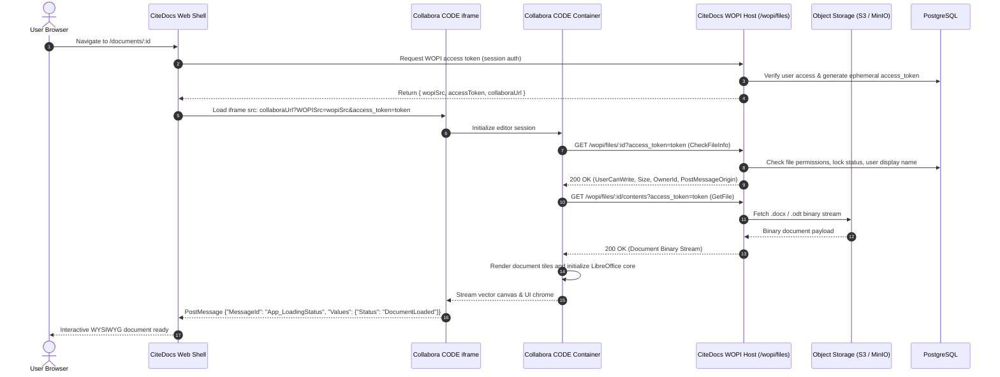
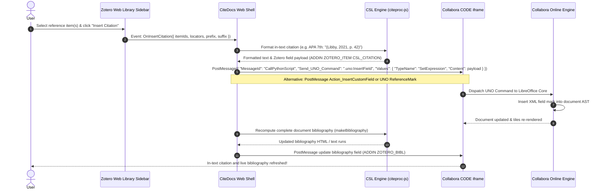
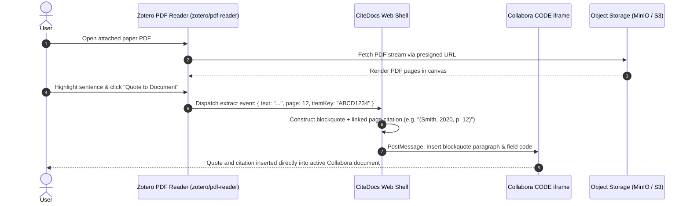
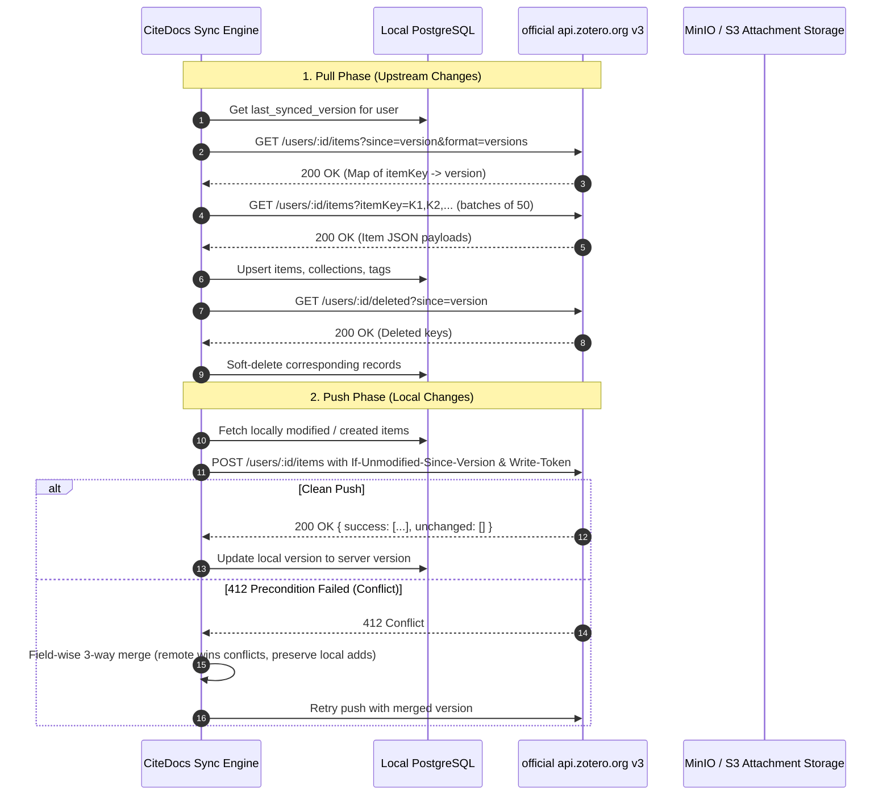
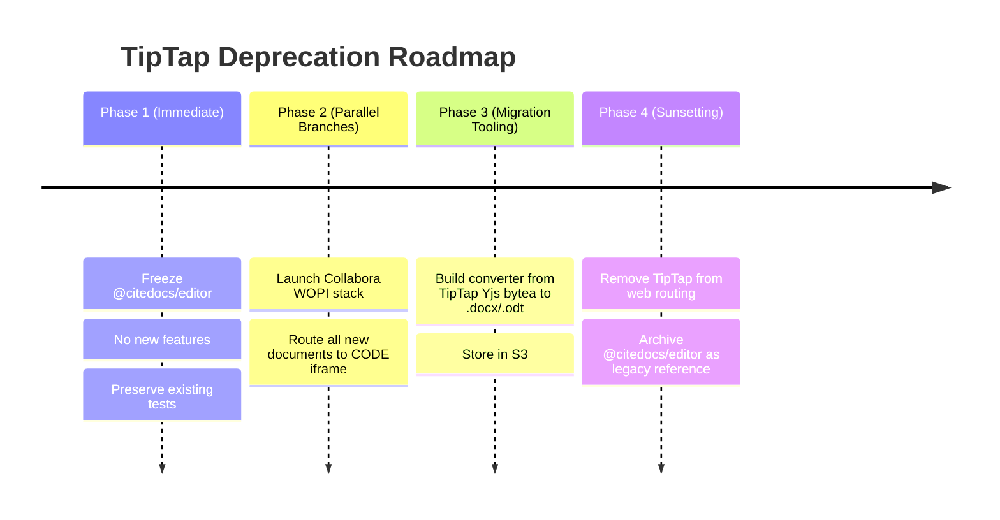

# ADR-001: Integration Architecture — Collabora Online (CODE) and the Open-Source Zotero Ecosystem

| Field | Value |
| :--- | :--- |
| **Status** | **Accepted / Binding** |
| **Date** | 2026-10-16 |
| **Author** | CiteDocs Core Architecture Team |
| **Decision Scope** | Monorepo Architectural Direction & Component Strategy |
| **Supersedes** | Milestone 1 / Milestone 4 TipTap-centric bespoke word processor roadmap |

---

## 1. Context and Problem Statement

Scientific and academic writing requires two foundational, extraordinarily intricate software systems:
1. **A full-featured, standard-compliant word processor:** Capable of strict page layout (A4/Letter), multi-level headers and footers, footnotes and endnotes, tables, images, track changes (suggesting mode), threaded comments, and native OpenDocument (`.odt`) / Microsoft Word (`.docx`) file compatibility.
2. **A comprehensive reference and bibliography manager:** Capable of storing hierarchical collections, tags, notes, extracting PDF annotations, resolving identifiers (DOI, ISBN, PMID, arXiv) through publisher translators, dynamically rendering citations and bibliographies across 10,000+ Citation Style Language (CSL) styles, and synchronizing with remote libraries.

In Milestone 0 through Milestone 4 of CiteDocs, the project attempted to build both domains from scratch:
- A bespoke browser-based rich-text editor canvas built atop **TipTap v3 + ProseMirror + Yjs**, attempting to emulate Google Docs typography, pagination, suggestion marks, footnote layouts, and custom citation atoms.
- A bespoke reference management library and synchronization layer.

### The Problem
Building a production-grade word processor with true paginated typography, footnote balancing, complex table manipulation, Word field-code roundtripping, and collaborative track changes requires tens of person-years of specialized engineering. Concurrently, re-engineering Zotero's extensive translator ecosystem, desktop/web library UI, and PDF annotation viewer duplicates hundreds of person-years of battle-tested open-source development.

Furthermore, academic users require strict fidelity when exporting documents to thesis advisors, co-authors, and publisher submission portals using Word (`.docx`) or LibreOffice (`.odt`), with functional field codes (`ADDIN ZOTERO_ITEM CSL_CITATION` and `ADDIN ZOTERO_BIBL CSL_BIBLIOGRAPHY`) that work out of the box with desktop plugins.

---

## 2. Decision: The Integration Principle

**CiteDocs adopts a strict, binding architecture direction:**
> **Do not reimplement Zotero. Do not reimplement a word processor.**  
> **Integrate real, battle-tested open-source components into a unified, zero-install, web-native platform.**

### 2.1 The Core Open-Source Pillars

Instead of custom implementations, CiteDocs embeds and orchestrates mature open-source projects:

1. **Document Authoring Engine: Collabora Online (CODE)**
   - Embedded directly in the browser via an `<iframe>` communicating over the **WOPI (Web Application Open Platform Interface)** REST protocol and browser `PostMessage` API.
   - Provides 100% fidelity with LibreOffice Writer and Microsoft Word OpenXML, including real pagination, footnote management, tables, track changes, comments, and native OpenDocument/OpenXML field marks.
   - Fully web-based: Users install **nothing** on their local devices (works seamlessly on desktop browsers, Chromebooks, iPads, and mobile tablets).

2. **Bibliographic Reference Suite: Zotero Open-Source Components**
   - **`zotero/web-library`:** Zotero's official React/Redux web client UI, embedded as CiteDocs' reference management sidebar and library browser.
   - **`zotero/translation-server`:** The official Node.js microservice executing Zotero's library of hundreds of publisher-specific translators for identifier resolution (DOI, ISBN, PMID, arXiv, URLs).
   - **`citeproc-js` + CSL Styles Repository:** The official JavaScript CSL 1.0.2 processor coupled with the complete `citation-style-language/styles` catalog (10,000+ journal styles) and `locales`.
   - **`zotero/pdf-reader`:** Zotero's official PDF reader (derived from PDF.js), supporting color-coded highlights, rectangle annotations, and page-anchored note extraction.
   - **Zotero Field Code Format:** Standard `ADDIN ZOTERO_ITEM CSL_CITATION` and `ADDIN ZOTERO_BIBL` representations in `.docx` and `.odt`, preserving full roundtrip fidelity with Zotero desktop plugins.
   - **`zotero/dataserver` (Optional/Pluggable):** Self-hostable backend data server for local synchronization or direct cloud sync with official `zotero.org` Web API v3.

### 2.2 CiteDocs' Proprietary Value Layer

CiteDocs does not duplicate the editor or reference manager. Instead, CiteDocs provides the **unifying cloud fabric**:
- **Authentication & Multi-Tenant Identity:** Free registration via Email (Argon2id), Google OAuth 2.0, and ORCID OAuth 2.0.
- **Per-User Cloud Storage:** Object storage (MinIO for local dev and self-hosting; AWS S3 / Cloudflare R2 for hosted deployments) providing ≥5 GB free storage per student for documents, revisions, and PDF attachments.
- **Per-User Zotero Account Linking:** Secure credential vault storing encrypted-at-rest API keys or OAuth tokens connecting to `zotero.org`.
- **WOPI Host Implementation:** Fastify-based REST server implementing the Microsoft/Collabora WOPI specification to serve, lock, and persist documents to S3.
- **Inter-Component Glue:** Reactive browser orchestration bridging Collabora's `PostMessage` bus with the Zotero web-library sidebar and PDF reader.

### 2.3 Legacy Status of TipTap Editor (`packages/editor`)

The existing `@citedocs/editor` package (TipTap v3, ProseMirror schemas, and custom suggestion/footnote extensions) is officially classified as **LEGACY**:
- **Do not extend it.**
- **Do not delete it.** It remains preserved in the repository for backwards compatibility, migration utilities, and test suites.
- A phased deprecation plan is outlined in §6.

---

## 3. High-Level Component Topology

```mermaid
flowchart TD
    subgraph ClientBrowser["User Browser (Zero Local Installation)"]
        CiteDocsApp["CiteDocs Shell (React 19 / Vite SPA)"]
        WebLibSidebar["Zotero Web Library Sidebar (zotero/web-library)"]
        PDFReaderModal["Zotero PDF Reader (zotero/pdf-reader)"]
        CollaboraIframe["Collabora Online CODE Canvas (iframe)"]

        CiteDocsApp <-->|DOM Event / State| WebLibSidebar
        CiteDocsApp <-->|DOM Event / State| PDFReaderModal
        CiteDocsApp <-->|PostMessage Bus| CollaboraIframe
    end

    subgraph EdgeGateway["Ingress & Edge Layer"]
        ReverseProxy["Reverse Proxy / Nginx / Traefik (HTTPS / WSS)"]
    end

    subgraph CiteDocsBackend["CiteDocs Application Services (apps/server)"]
        FastifyServer["Fastify REST & API Gateway"]
        WOPIHost["WOPI Host Service (/wopi/files/*)"]
        AuthService["Auth & Multi-Tenant Manager (Argon2id, OAuth)"]
        ZoteroSyncWorker["Zotero 2-Way Sync Engine (Web API v3)"]
        CSLEngine["CSL Engine (@citedocs/csl-engine / citeproc-js)"]
    end

    subgraph ExternalContainers["Open-Source Microservices (Docker Compose)"]
        CollaboraCODE["Collabora Online CODE Server (Docker: port 9980)"]
        TransServer["Zotero Translation Server (Docker: port 1969)"]
        OptionalDataServer["Optional Zotero Dataserver"]
    end

    subgraph StorageTier["Persistence Tier"]
        PostgresDB[("PostgreSQL 16 (Users, Items, Shares, WOPI Locks)")]
        ObjectStore[("S3 / MinIO (DOCX, ODT, PDFs, Snapshots)")]
    end

    subgraph ExternalEcosystem["External Services"]
        ZoteroCloud["Official zotero.org API v3"]
        AcademicAPIs["Crossref / PubMed / arXiv / Unpaywall"]
        CSLGitHub["Official CSL Styles & Locales Repos"]
    end

    %% Client to Ingress
    CiteDocsApp <==>|HTTPS / REST| ReverseProxy
    CollaboraIframe <==>|WSS / WOPI Tile Stream| ReverseProxy

    %% Ingress to Services
    ReverseProxy <--> FastifyServer
    ReverseProxy <--> CollaboraCODE

    %% Collabora to WOPI Host
    CollaboraCODE <==>|WOPI REST (CheckFileInfo / GetFile / PutFile)| WOPIHost

    %% Backend to Microservices & Storage
    FastifyServer <--> PostgresDB
    WOPIHost <--> ObjectStore
    FastifyServer <--> ObjectStore
    FastifyServer <--> TransServer
    FastifyServer <--> CSLEngine
    ZoteroSyncWorker <--> PostgresDB
    ZoteroSyncWorker <--> ObjectStore

    %% External Connections
    TransServer <--> AcademicAPIs
    ZoteroSyncWorker <--> ZoteroCloud
    CSLEngine <--> CSLGitHub
    OptionalDataServer -.-> PostgresDB
```

---

## 4. End-to-End Data Flows

### 4.1 Flow 1: Open Document via WOPI and Collabora CODE

Collabora Online interacts with CiteDocs exclusively through the standard WOPI (Web Application Open Platform Interface) protocol:



### 4.2 Flow 2: Insert Citation into Collabora Document

When a user selects an item from their Zotero library sidebar or quick citation popup:



### 4.3 Flow 3: Add Item by Identifier (DOI, ISBN, PMID, arXiv, URL)

```mermaid
sequenceDiagram
    autonumber
    actor User as User
    participant Shell as CiteDocs Magic Add Bar
    participant Server as CiteDocs Fastify API
    participant Trans as zotero/translation-server
    participant Crossref as Academic APIs (Crossref/arXiv/Unpaywall)
    participant DB as PostgreSQL
    participant S3 as Object Storage (MinIO / S3)

    User->>Shell: Paste DOI "10.1038/s41586-021-03392-y" & submit
    Shell->>Server: POST /api/items/from-identifier { identifier } (X-User-Id)
    Server->>Trans: POST /search (text/plain: "10.1038/s41586-021-03392-y")
    Trans->>Crossref: Resolve metadata via Crossref translator
    Crossref-->>Trans: Return raw bibliographic JSON
    Trans-->>Server: Return normalized Zotero item JSON

    Server->>Server: Convert to CSL-JSON & generate Zotero key
    opt Open Access PDF Available (Unpaywall)
        Server->>AcademicAPIs: Download open-access PDF
        AcademicAPIs-->>Server: PDF bytes
        Server->>S3: Upload PDF to user bucket: /users/:userId/attachments/:key.pdf
    end

    Server->>DB: Insert record into library_items, item_creators, attachments
    DB-->>Server: Saved entity
    Server-->>Shell: 201 Created { item, cslItem, attachment }
    Shell-->>User: Result card displayed; item added to live Zotero sidebar
```

### 4.4 Flow 4: PDF Annotation and Quote Extraction



### 4.5 Flow 5: Two-Way Synchronization with zotero.org



---

## 5. Comprehensive License and Legal Analysis

Because CiteDocs links, embeds, and runs multiple distinct open-source software packages, a rigorous intellectual property analysis is essential.

### 5.1 License Inventory of Integrated Components

| Component | Upstream Repository | Upstream License | Linking / Interaction Mechanism |
| :--- | :--- | :--- | :--- |
| **`zotero/web-library`** | `github.com/zotero/web-library` | **GNU AGPL-3.0** | Bundled React client component (JavaScript/TypeScript) |
| **`zotero/translation-server`** | `github.com/zotero/translation-server` | **GNU AGPL-3.0** | Independent Docker microservice communicating over HTTP REST |
| **`citeproc-js`** | `github.com/Juris-M/citeproc-js` | **Dual CPAL 1.0 / AGPL-3.0** | Bundled NPM dependency (`@citedocs/csl-engine`) |
| **CSL Styles & Locales** | `github.com/citation-style-language/styles` | **CC BY-SA 3.0** | Declarative XML data assets; attribution maintained |
| **`zotero/pdf-reader`** | `github.com/zotero/pdf-reader` | **GNU AGPL-3.0** | Bundled React/Canvas client component |
| **Collabora Online (CODE)** | `github.com/CollaboraOnline/online` | **MPL-2.0** | Independent server container; browser `<iframe>` + PostMessage |
| **Zotero LibreOffice Code** | `github.com/zotero/zotero-libreoffice-integration` | **GNU AGPL-3.0** | UNO scripts / field code specifications |
| **`zotero/dataserver`** | `github.com/zotero/dataserver` | **GNU AGPL-3.0** | Optional standalone backend service over HTTP REST |

---

### 5.2 Deep Dive: The AGPL-3.0 Network-Use Clause (§13)

Section 13 of the **GNU Affero General Public License (AGPL-3.0)** states:
> *"Notwithstanding any other provision of this License, if you modify the Program, your modified version must prominently offer all users interacting with it remotely through a computer network ... an opportunity to receive the Corresponding Source of your version by providing access to the Corresponding Source from a network server at no charge..."*

#### Legal Implications for CiteDocs:
1. **Frontend Integration (`web-library` and `pdf-reader`):**
   - Incorporating `zotero/web-library` and `zotero/pdf-reader` into the CiteDocs React frontend directly links AGPL-3.0 JavaScript into the client application bundle. Under copyright law and the Free Software Foundation's interpretation, this creates a combined work governed by the terms of AGPL-3.0.
2. **Backend Engine (`citeproc-js`):**
   - `citeproc-js` is dual-licensed under CPAL 1.0 and AGPL-3.0. By electing AGPL-3.0, it harmonizes completely with the rest of the Zotero stack without triggering conflicting attribution banner clauses.
3. **The Network Interaction Boundary:**
   - Because CiteDocs is delivered as a network web application, users interact with it remotely over HTTP/WebSocket. Under AGPL §13, any deployment of CiteDocs that modifies or integrates AGPL components must offer the full Corresponding Source Code to every connecting user.
4. **Current Status vs. Legal Compliance:**
   - CiteDocs was initially initialized with an MIT license declaration in `package.json` and `README.md`.
   - **Continuing under MIT while bundling AGPL-3.0 components creates an irreconcilable license violation.** A project cannot grant permissive MIT rights to third parties over codebases that link or incorporate copyleft AGPL-3.0 code.

---

### 5.3 Deep Dive: Collabora Online (CODE) and MPL-2.0

Collabora Online Development Edition (CODE) is licensed under the **Mozilla Public License 2.0 (MPL-2.0)**:
1. **File-Level Copyleft:**
   - MPL-2.0 is a file-level (weak) copyleft license. Modifications to CODE's own source files must be made available under MPL-2.0.
   - However, calling CODE via external interfaces—specifically the **WOPI REST API** and browser **`PostMessage` iframe communications**—constitutes standard network interoperability ("Larger Work" boundary).
   - This architectural separation guarantees that Collabora CODE's MPL-2.0 and CiteDocs' AGPL-3.0 layers remain cleanly decoupled at the process and protocol boundary.
2. **CODE Community Usage Limits & Branding:**
   - The free community edition (CODE) includes a soft warning banner when concurrent document editing exceeds **20 simultaneous connections** or **10 concurrent documents**.
   - **Academic & Non-Commercial Compliance:** This soft limit does not restrict volunteer self-hosting for individual researchers, lab groups, or small student cohorts. If a large university deployment exceeds these thresholds, operators can run horizontally scaled CODE clusters or purchase a Collabora Online Enterprise support subscription.
   - Collabora Online logos and copyright notices embedded within the CODE iframe must be retained in accordance with Collabora trademark and attribution guidelines.

---

### 5.4 Recommendation: Relicense CiteDocs to AGPL-3.0

> [!IMPORTANT]
> **Definitive Recommendation:** CiteDocs should officially and cleanly relicense to **GNU Affero General Public License v3.0 (AGPL-3.0-only or AGPL-3.0-or-later)**.

Relicensing to AGPL-3.0 accomplishes four vital objectives:
1. **Complete Legal Compliance:** Eliminates any copyright clash with `zotero/web-library`, `zotero/pdf-reader`, and `citeproc-js`.
2. **Protection of Academic Commons:** Ensures that CiteDocs remains permanently free, open-source, and non-commercial, preventing proprietary vendors from creating closed, paywalled forks without sharing source code.
3. **Alignment with Upstream:** Matches the licensing philosophy of Zotero and the wider open-source scholarly ecosystem.
4. **Clean Developer Clarity:** Monorepo developers and self-hosters operate under one transparent, unified copyleft umbrella.

#### Concrete Implementation Steps (Pending User Approval):
- [ ] **Step 1:** Create `LICENSE` file at repo root containing the official text of GNU AGPL-3.0.
- [ ] **Step 2:** Update `"license": "AGPL-3.0-only"` in root `package.json` and all package/app `package.json` files (`apps/server`, `apps/web`, `packages/*`).
- [ ] **Step 3:** Add an AGPL §13 compliant "Source Code" link in the CiteDocs web UI (e.g. Help / About modal and footer) linking directly to the corresponding Git repository and release commit.
- [ ] **Step 4:** Document contributor guidelines confirming all incoming contributions are licensed under AGPL-3.0.

*(Note: In accordance with project instructions, the `LICENSE` file is NOT created in this ADR; it awaits final user authorization).*

---

## 6. Deprecation and Migration Plan for TipTap (`packages/editor`)

CiteDocs' initial implementation included `@citedocs/editor` using TipTap v3, ProseMirror, and custom suggestion marks. This approach is superseded by Collabora Online CODE.



### Phase 1: Feature Freeze (Immediate)
- Mark `@citedocs/editor` as `@deprecated` in `packages/editor/package.json`.
- Reject any new features, schema extensions, or TipTap UI components.
- Retain existing unit tests to prevent regression of data structures.

### Phase 2: Dual Routing and Default Switch
- The web application defaults to the Collabora Online CODE iframe view for all newly created documents.
- Existing documents with TipTap Yjs states can be viewed in read-only legacy mode or triggered for migration.

### Phase 3: Automated Document Converter
- Use `@citedocs/docx-exporter` and headless LibreOffice conversion to serialize legacy TipTap/Yjs JSON documents into standard `.docx` files.
- Upload converted `.docx` files to the user's MinIO/S3 bucket with an updated `documents.file_path` pointer.

### Phase 4: Archival
- Remove TipTap rendering components from `apps/web`.
- Move `packages/editor` to `packages/legacy-editor` or archive it as a historical reference package.

---

## 7. Consequences of this Decision

### Positive Consequences
- **Instant Google Docs Parity:** Collabora Online delivers genuine, mature, enterprise-grade typography, paged layouts, real-time collaboration, revision history, track changes, comments, and table styling out of the box.
- **Zero Local Client Footprint:** Academic researchers and students can open and edit full academic papers on Chromebooks, tablets, iPads, and low-spec laptops with zero local installation.
- **Native 100% Interoperability:** Exporting documents to Word (`.docx`) or LibreOffice (`.odt`) retains native Zotero field codes (`ADDIN ZOTERO_ITEM CSL_CITATION`). Academic co-authors using Microsoft Word or LibreOffice desktop extensions experience zero formatting corruption.
- **Vastly Reduced Maintenance Surface:** The CiteDocs team no longer needs to maintain custom layout engines, text measurement algorithms, or complex cursor reconciliation logic. Engineering effort focuses exclusively on cloud storage, authentication, and bibliographic intelligence.

### Negative Consequences and Technical Trade-offs
- **Server Deployment Footprint:** Collabora Online CODE runs as a Docker container requiring ~300–500 MB of RAM for the LibreOffice core service, increasing self-hosting hardware requirements compared to a pure static frontend.
  - *Mitigation:* The entire Docker Compose stack (Fastify + Collabora CODE + Postgres + MinIO + translation-server) comfortably fits inside 1.5–2 GB RAM, easily running on a standard $10/month VPS or self-hosted home server.
- **Asynchronous WOPI Protocol Complexity:** Document state persistence relies on WOPI REST handshakes, lock management, and postMessage event plumbing rather than direct client-side CRDT manipulation.
  - *Mitigation:* WOPI is an internationally standardized, heavily documented protocol used by Microsoft 365, Google Workspace, and Collabora. CiteDocs' `apps/server` WOPI host implements well-defined endpoints covered by rigorous integration tests.
- **Network Latency Sensitivity:** Document rendering occurs server-side in Collabora CODE and streams vector tiles to the browser.
  - *Mitigation:* Collabora CODE employs highly optimized WebSockets and tile caching, providing responsive $<30\text{ ms}$ typing latency on standard broadband and 4G/5G connections.

---

## 8. Alternatives Considered

| Alternative | Evaluation & Rationale for Rejection |
| :--- | :--- |
| **Continue Bespoke TipTap / ProseMirror (`packages/editor`)** | **Rejected.** Emulating physical pagination, page margin rulers, complex footnote balancing, table cell merging, Word field-code roundtrips, and suggesting mode would require years of dedicated development without ever reaching 100% LibreOffice/Word parity. |
| **Onlydocs / OnlyOffice Document Server** | **Rejected.** OnlyOffice Community Edition applies stringent 20-connection concurrent limits enforced by hard connection rejection (rather than CODE's soft notice), uses a more restrictive AGPL/custom licensing mix, and lacks Collabora's tight native integration with LibreOffice OpenDocument field standards. |
| **Client-side WASM LibreOffice (LibreOffice WASM)** | **Rejected.** LibreOffice WASM remains experimental, requires massive initial downloads (>100 MB webassembly bundle), suffers from high startup latency on mobile/tablet devices, and lacks mature multi-user real-time collaboration. |
| **Standalone Zotero Desktop WebDAV Sync Only** | **Rejected.** Forcing students to install Zotero Desktop and configure custom WebDAV fails the core product requirement of a zero-install, ubiquitous web application accessible from any browser on any device. |

---

## 9. Alignment with Parallel Workstreams

To avoid git merge conflicts with parallel branches running concurrently:
1. **`cd-wopi-host`:** Implements `apps/server` WOPI REST endpoints (`/wopi/files/:id`, `/wopi/files/:id/contents`, locks, `CheckFileInfo`).
2. **`cd-zotero-weblib`:** Implements `apps/web` integration of `zotero/web-library` sidebar, item filtering, and `zotero/translation-server` UI wiring.
3. **`cd-cite-insert`:** Implements the PostMessage bridge and UNO command dispatching for inserting formatted CSL citations and updating `ADDIN ZOTERO_ITEM` fields inside the Collabora iframe.
4. **`cd-adr-proto` (This Work):** Provides the overarching architectural contract, component boundaries, data flow specifications, and legal framework governing all three workstreams.
