# CiteDocs Technical Research Report

This document compiles the exhaustive technical research and specifications underpinning the architecture of **CiteDocs**: an open-source, Google Docs-grade collaborative word processor with deep, native Zotero reference management and live Citation Style Language (CSL) formatting.

---

## 1. Zotero Web API v3 Deep Dive

### 1.1 Architecture & Protocols
The Zotero Web API v3 (`https://api.zotero.org`) is a RESTful JSON/AtomPub API supporting read/write operations on individual user and group bibliographic libraries.

* **Base URL Schemas:**
  * User Libraries: `https://api.zotero.org/users/<userID>/`
  * Group Libraries: `https://api.zotero.org/groups/<groupID>/`
* **Core Object Collections:**
  * `/items` (top-level bibliographic items, child attachments, notes, annotations)
  * `/collections` (hierarchical taxonomy tree)
  * `/searches` (saved search filters with complex query criteria)
  * `/tags` (user and automatic tags)
  * `/deleted` (tombstone records of deleted items, collections, searches)

### 1.2 Two-Way Synchronization Mechanics
Zotero uses a monotonic integer versioning model with optimistic concurrency control.

```mermaid
sequenceDiagram
    autonumber
    actor Client as CiteDocs Sync Engine
    participant Server as Zotero Web API v3
    participant DB as CiteDocs Postgres

    Note over Client,Server: Incremental Downstream Pull
    Client->>Server: GET /users/{userId}/items?newer={lastItemVersion}
    Note right of Client: Header: If-Modified-Since-Version: {lastLibVersion}
    alt Library Unchanged
        Server-->>Client: 304 Not Modified
    else Library Modified
        Server-->>Client: 200 OK (Items Array) + Header Last-Modified-Version: {newVersion}
        Client->>DB: Upsert Items & Update Library Version {newVersion}
    end

    Note over Client,Server: Upstream Push with Concurrency Protection
    Client->>Server: POST /users/{userId}/items (Batch of up to 50 items)
    Note right of Client: Header: If-Unmodified-Since-Version: {lastLibVersion}
    alt Concurrency Conflict (Server is newer)
        Server-->>Client: 412 Precondition Failed
        Client->>Client: Trigger Conflict Resolution & Re-sync
    else Success
        Server-->>Client: 200 OK (Created/Updated Item Keys & Versions)
        Client->>DB: Update Local Sync Status
    end
```



* **Version Management:**
  * Every library has an integer `version`.
  * Every item, collection, and search object has an integer `version`.
  * Responses return `Last-Modified-Version: <int>` header.
* **Tombstones & Deletions:**
  * Querying `GET /users/<userID>/deleted?since=<version>` returns JSON `{ "items": ["KEY1", "KEY2"], "collections": ["COLL1"], "searches": [] }`.
  * CiteDocs uses this to purge or mark items as deleted in the local mirror without full library re-indexing.
* **Attachment Storage & File Sync:**
  * Files are stored as child items of type `attachment` with `linkMode`:
    * `imported_file` (stored in Zotero server storage or WebDAV/S3)
    * `linked_file` (local filesystem URI)
    * `imported_url` / `linked_url` (web snapshots or direct URLs)
  * File upload protocol:
    1. `GET /users/<userID>/items/<itemKey>/file` with upload authorization request (`Content-Type: application/x-www-form-urlencoded`, `upload=1`).
    2. Server returns JSON with upload URL (S3 presigned POST parameters or Zotero storage endpoint).
    3. Client uploads binary payload directly to storage endpoint with MD5 verification.
    4. Client registers completion: `POST /users/<userID>/items/<itemKey>/file` (`upload=<uploadKey>`).
* **Authentication:**
  * Personal API Keys: Generated via `zotero.org/settings/keys/new` with granular permissions (`allowLibrary`, `allowWrite`, `allowGroups`).
  * OAuth 1.0a: Supported for 3rd-party web logins.

---

## 2. Zotero Translation Server

The official `zotero/translation-server` is a standalone Node.js microservice running the complete catalog of Zotero's open-source translator scripts (~500+ scraping and translation scripts).

### 2.1 Microservice Specification
* **Docker Image:** `zotero/translation-server:latest`
* **Default Port:** `1969`
* **Core Endpoints:**
  1. `POST /web`:
     * Input: Plain text URL or JSON `{ "url": "..." }`
     * Processing: Scrapes HTML metadata (Highwire Press, Dublin Core, OpenGraph, JSON-LD, site-specific translators for Nature, Science, IEEE, PubMed, ACM, NYT, JSTOR, etc.).
     * Output: Array of Zotero item JSON objects with extracted title, authors, journal, volume, issue, DOI, abstract, and snapshot URLs.
  2. `POST /import`:
     * Input: Raw bibliographic file string (BibTeX, RIS, EndNote, RefMan, CSL-JSON, MODS, Wikipedia citation).
     * Output: Normalized Zotero item JSON objects.
  3. `POST /export?format=<format>`:
     * Input: Array of Zotero item JSON objects.
     * Output: Serialized string in requested format (`bibtex`, `biblatex`, `ris`, `csljson`, `rdf_zotero`).
  4. `POST /search`:
     * Input: JSON `{ "query": "10.1038/s41586-021-03392-y" }` (DOI, ISBN, PMID, or arXiv ID).
     * Output: High-accuracy metadata from Crossref, DataCite, PubMed, OpenLibrary, or arXiv API.

---

## 3. citeproc-js & CSL 1.0.2 Architecture

`citeproc-js` (authored by Frank Bennett) is the reference JavaScript implementation of Citation Style Language (CSL 1.0.2), trusted by Zotero, Mendeley, and Papers.

### 3.1 Sys Object Contract
`citeproc-js` requires an execution host object (`sys`) providing synchronous callbacks:

```typescript
export interface CiteprocSys {
  retrieveItem(id: string | number): CSL.Item;
  retrieveLocale(lang: string): string | object;
  variableWrapper?(params: any, prePunct: string, str: string, postPunct: string): string;
}
```

### 3.2 Dynamic Citation Cluster Processing
In a live collaborative document, citations are clustered in text (e.g. `[1, 2]` or `(Smith, 2020; Jones, 2021)`) and can change dynamically based on:
1. **Document position:** Initial citation vs. subsequent citation (e.g. full author list vs. *et al.*, or Latin abbreviations like *ibid.* and *op. cit.*).
2. **Disambiguation:** If two authors share the same surname and publication year, initials or given names are automatically injected.
3. **Numbering:** In numeric styles (e.g., IEEE, Vancouver), citations are ordered either by first appearance in the document or alphabetically.

The engine coordinates this via:
* `engine.updateItems(itemIds)`: Registers or refreshes cached item metadata.
* `engine.processCitationCluster(citation, citationsPre, citationsPost)`: Evaluates a cluster against its preceding and succeeding document context, returning an array of index/HTML pairs for all citations in the document that were affected by the change.
* `engine.makeBibliography(filter?)`: Returns `[params, entries]` where `params` contains hanging indent, entry spacing, and line spacing; and `entries` contains the rendered HTML strings for each bibliography entry.

### 3.3 CSL Repositories & 10,000+ Style Catalog
* **Official Repositories:**
  * `citation-style-language/styles`: Over 10,000 styles.
    * Independent styles (~2,000): Full CSL XML specifying macros, layout, citation, and bibliography rules.
    * Dependent styles (~8,000): Lightweight XML pointer referencing an independent parent style (e.g., *American Journal of Pathology* points to *nlm*).
  * `citation-style-language/locales`: Language localization XML files (`locales-en-US.xml`, `locales-de-DE.xml`, `locales-fr-FR.xml`, `locales-tr-TR.xml`, etc.).
* **Indexing & Lazy Loading Architecture:**
  * A pre-built compressed SQLite / JSON index is distributed containing metadata for all 10,000+ styles (`id`, `title`, `shortTitle`, `categories`, `citationFormat`, `independentParent`, `updated`).
  * The top 100 most common academic styles (APA 7th, IEEE, Chicago author-date, Chicago notes-bibliography, MLA 9th, Harvard, Vancouver, Nature, Science, ACM, Elsevier) are bundled locally in the client cache for zero-latency offline access.
  * Remaining styles are fetched on demand from the CiteDocs CSL API / CDN and cached in IndexedDB.

---

## 4. Google Docs Feature Parity in TipTap / ProseMirror

Google Docs is the global benchmark for web-based document editing. Delivering full parity in CiteDocs requires precise mapping to TipTap v2 and ProseMirror extensions:

| Google Docs Feature | TipTap / ProseMirror Implementation Strategy |
| :--- | :--- |
| **Rich Text & Typography** | `@tiptap/extension-starter-kit`, `FontFamily`, `Color`, `Highlight`, `Subscript`, `Superscript`, `TextAlign`, `LineHeight`. |
| **Headings & Outline** | `@tiptap/extension-heading` (Levels 1–6) + reactive document outline extracted from ProseMirror document node hierarchy with anchor scrolling. |
| **Tables** | `@tiptap/extension-table`, `TableRow`, `TableCell`, `TableHeader` with column resizing, cell background coloring, and cell merging/splitting. |
| **Images** | Extended `@tiptap/extension-image` with captioning node, resize handles, floating/inline alignment, and S3 asset upload. |
| **Suggesting Mode (Track Changes)** | Custom ProseMirror mark-based system (`suggestion-insert` and `suggestion-delete`) with `suggestionId`, `userId`, `userName`, `userColor`, `timestamp`. Non-destructive text editing where deletes mark text as strikethrough and inserts mark text as colored underline. Interactive Accept/Reject UI. |
| **Threaded Comments** | Custom `comment` mark referencing unique `commentThreadId`. Sidebar comment stream synced to editor anchor positions. Resolved/reopened lifecycle. |
| **Real-Time Collaboration** | Yjs CRDT + `@tiptap/extension-collaboration` (`y-prosemirror`) with Hocuspocus WebSocket synchronization. |
| **Live Cursors & Presence** | `@tiptap/extension-collaboration-cursor` (Yjs Awareness) rendering remote user cursors, selection bounding boxes, names, and avatar badges. |
| **Version History** | Yjs snapshots (`Y.encodeSnapshot`, `Y.createDocFromSnapshot`) combined with persistent server-side document checkpoint log. Live visual diffing. |
| **Page Layout & Print View** | Paged layout rendering engine simulating physical sheets (Letter / A4) with page margins (1 inch default), ruler, visual page breaks, and `@media print` CSS. |
| **Footnotes & Endnotes** | Custom inline `footnote` node with numeric marker and responsive bottom-of-page dock or document-end reference drawer. |
| **Math & Equations** | KaTeX-powered math node (`@tiptap/extension-mathematics`) supporting inline `$E=mc^2$` and block display equations with visual LaTeX editor modal. |
| **Offline First & PWA** | `y-indexeddb` for instant offline persistence + Workbox Service Worker caching app shell and static CSL assets. Auto-sync on reconnect. |
| **Find & Replace** | ProseMirror decoration plugin supporting regex, case-matching, whole-word search, match cycling, and replace / replace-all transactions. |
| **Word & Readability Count** | Reactive ProseMirror plugin calculating words, characters, characters (no spaces), pages, reading time, and Flesch-Kincaid grade level. |
| **Mobile & Touch Parity** | Responsive floating toolbar, touch-optimized selection handles, slide-over sheets for comments/library, and bottom action bar on phones. |

---

## 5. Zotero DOCX Field Code Compatibility (`ADDIN ZOTERO_ITEM`)

A critical requirement for academic researchers is exporting a document to `.docx` such that colleagues opening it in Microsoft Word or LibreOffice with the official Zotero desktop plugin can click **Refresh** or **Add/Edit Citation** and have Zotero immediately recognize every citation and the bibliography.

### 5.1 Word OpenXML Field Code Schema
In Microsoft Word `.docx` documents (inside `word/document.xml`), Zotero encodes citations either as a simple field (`<w:fldSimple>`) or a complex field (`<w:fldChar>` sequence).

#### Complex Field Structure:
```xml
<w:p>
  <w:r><w:t>As demonstrated in recent findings </w:t></w:r>
  <!-- Field Start -->
  <w:fldChar w:fldCharType="begin"/>
  <w:instrText xml:space="preserve"> ADDIN ZOTERO_ITEM CSL_CITATION {"citationID":"a3b8g12","citationItems":[{"id":104,"uris":["http://zotero.org/users/12345/items/ABC12345"],"locator":"42","label":"page"}],"properties":{"formattedCitation":"(Doe, 2023, p. 42)","plainCitation":"(Doe, 2023, p. 42)","dontUpdate":false}} </w:instrText>
  <w:fldChar w:fldCharType="separate"/>
  <!-- Cached Visual Display Run -->
  <w:r>
    <w:rPr><w:rStyle w:val="ZoteroCitation"/></w:rPr>
    <w:t>(Doe, 2023, p. 42)</w:t>
  </w:r>
  <!-- Field End -->
  <w:fldChar w:fldCharType="end"/>
  <w:r><w:t>, the results are conclusive.</w:t></w:r>
</w:p>
```

#### Bibliography Field Structure:
```xml
<w:p>
  <w:fldChar w:fldCharType="begin"/>
  <w:instrText xml:space="preserve"> ADDIN ZOTERO_BIBL {"custom":[]} CSL_BIBLIOGRAPHY </w:instrText>
  <w:fldChar w:fldCharType="separate"/>
  <w:r><w:t>Doe, J. (2023). The Open Science Manifesto. Nature, 500, 40–45.</w:t></w:r>
  <w:fldChar w:fldCharType="end"/>
</w:p>
```

CiteDocs implements a custom DOCX exporter and importer (`packages/docx-exporter`) that parses and generates these precise OpenXML structures.

---

## 6. PDF.js & Annotation Extraction Architecture

* **Rendering Engine:** `pdfjs-dist` rendered to an HTML5 `<canvas>` layer with an aligned DOM `<div class="textLayer">` for native text selection and search.
* **Custom Annotation Canvas:**
  * SVG / HTML overlay tracking highlights (yellow `#fef08a`, green `#bbf7d0`, blue `#bfdbfe`, pink `#fbcfe8`, purple `#e9d5ff`).
  * Pointers store normalized coordinate bounding boxes `{ page: number, rects: [[x1, y1, x2, y2]] }` independent of display zoom or DPI.
* **Note & Quote Extraction Workflow:**
  1. User selects text in PDF reader.
  2. Floating quick-action popover offers:
     * **Highlight** (persists in item annotations)
     * **Copy with Citation** (copies quoted text + formatted in-text citation with page locator)
     * **Add to Doc** (directly inserts a blockquote with attached CiteDocs citation node into active document cursor position)
     * **Create Zotero Note** (saves child note item attached to parent bibliographic record).

---

## 7. Real-Time Collaboration: Yjs & Hocuspocus

* **Yjs CRDT:**
  * Document state is stored as a conflict-free replicated data type (`Y.Doc`).
  * The rich text state is represented as a `Y.XmlFragment` mapped to ProseMirror via `y-prosemirror`.
  * Concurrent edits, character typing, formatting changes, and suggestion insertions/deletions merge deterministically without a central locking mechanism.
* **Hocuspocus Server:**
  * Node.js WebSocket collaboration server by TipTap.
  * Hooks utilized:
    * `onAuthenticate`: Verifies JWT session token, checks document permission (owner, editor, commenter, viewer).
    * `onLoadDocument`: Loads binary Yjs document state from PostgreSQL (`documents` table bytea column).
    * `onStoreDocument`: Debounced write-back of document binary state and plain text / HTML summary to PostgreSQL.
    * `onAwarenessUpdate`: Broadcasts user cursors, selections, names, and presence colors.
  * Scaling: Integrated Redis adapter (`@hocuspocus/extension-redis`) distributes updates across multi-instance clusters.

---

## 8. Frontend Framework Selection: Vite + React SPA vs Next.js

A critical architectural decision is choosing between **Vite + React (SPA/PWA)** and **Next.js 15 (App Router)** for CiteDocs:

| Evaluation Dimension | Vite + React SPA/PWA | Next.js 15 App Router |
| :--- | :--- | :--- |
| **Editor Runtimes** | Ideal. TipTap, ProseMirror, Yjs, PDF.js, and citeproc-js are exclusively client-side DOM runtimes. Zero SSR hydration mismatches. | Requires `'use client'` on virtually all editor, PDF, and citation views. SSR provides no benefit to an active editing canvas. |
| **Offline / PWA** | Superb. Standard Service Worker / Workbox patterns enable full offline document editing with IndexedDB sync. | Complex to configure full offline PWA with App Router SSR/RSC caching. |
| **Build & Dev Speed** | Ultra-fast esbuild/Vite HMR (<50ms). Instant feedback loop during heavy canvas/editor development. | Webpack / Turbopack compilation can be slower for heavy multi-package monorepos. |
| **API & Server Coupling** | Clean decoupling. Frontend communicates with dedicated Hocuspocus WebSocket server and REST API via OpenAPI/tRPC. | API routes are convenient but WebSocket long-lived connections require a separate custom server anyway (Next.js serverless cannot host Yjs WebSockets). |
| **Self-Hosting Footprint** | Extremely low. Static files served via Nginx or Caddy (10MB RAM). | Requires Node.js SSR runtime for web pages (150MB+ RAM per container). |

**Architectural Recommendation:**
CiteDocs adopts **Vite + React 19** with TailwindCSS and Lucide Icons for the frontend web application (`apps/web`), paired with a high-performance **Fastify + Hocuspocus** Node.js server (`apps/server`) in a unified TypeScript pnpm monorepo. This provides the fastest editing experience, cleanest offline PWA capability, lowest self-hosting RAM consumption, and zero SSR hydration hurdles.
