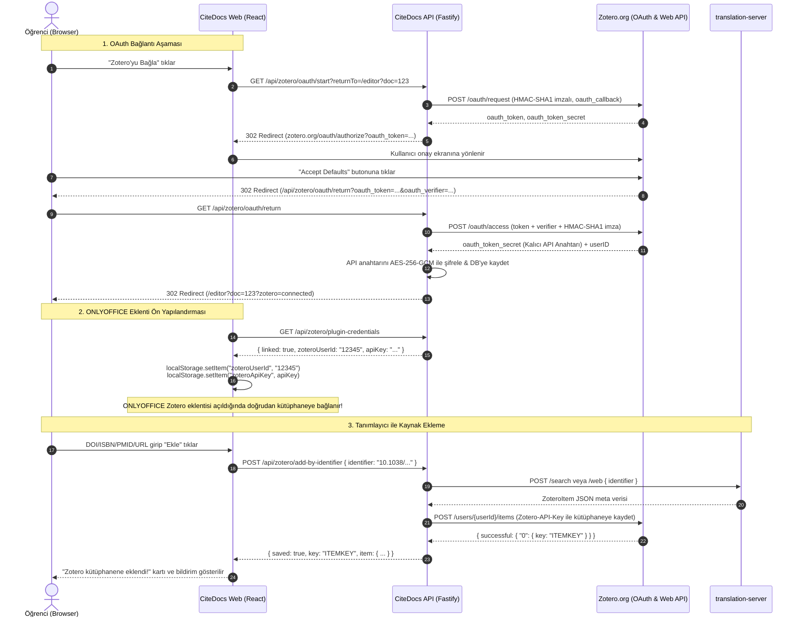

# Zotero OAuth 1.0a Integration Guide

Bu doküman, CiteDocs üzerinde öğrencilerin ve araştırmacıların hiçbir API anahtarı kopyalayıp yapıştırmadan (**zero-paste key**) tek tıkla Zotero hesaplarını bağlamalarını sağlayan **Zotero OAuth 1.0a** entegrasyonunun yapılandırmasını, zotero.org uygulama kaydını, gerekli ortam değişkenlerini ve sistem mimarisini açıklar.

---

## 1. Neden Zotero OAuth 1.0a?

CiteDocs, ONLYOFFICE Docs CE editörü ve Zotero referans ekosistemini web tarayıcısında entegre eder:
1. **Öğrenci Deneyimi:** Öğrencilerin zotero.org ayarlarına gidip manuel API anahtarı üretmesi, okuma/yazma izinlerini seçmesi ve bu anahtarı editöre yapıştırması gereksiz bir bilişsel yük ve hata kaynağıdır. OAuth 1.0a ile öğrenci yalnızca "Zotero'yu Bağla" butonuna basar, zotero.org onay ekranını onaylar ve otomatik olarak editöre döner.
2. **ONLYOFFICE Zotero Eklentisi Otomatik Konfigürasyonu:** Bağlantı tamamlandığında CiteDocs sunucusu kullanıcının `zoteroUserId` ve `zoteroApiKey` bilgilerini hazırlar. ONLYOFFICE editör sayfası açılırken bu bilgiler tarayıcı `localStorage` alanına yazılır. ONLYOFFICE içinde yerleşik Zotero eklentisi (`asc.{BFC5D5C6-89DE-4168-9565-ABD8D1E48711}`) başlatıldığında kullanıcıyı oturum açmış olarak karşılar.
3. **Tanımlayıcı ile Kaynak Ekleme (translation-server):** DOI, ISBN, PMID veya Web URL girildiğinde CiteDocs `zotero/translation-server` mikroservisi üzerinden üst verileri çözer ve Zotero Web API (`POST https://api.zotero.org/users/{userId}/items`) aracılığıyla doğrudan öğrencinin Zotero kütüphanesine yazar.

---

## 2. zotero.org Uygulama Kaydı (App Registration)

Zotero OAuth 1.0a istemcisi olarak çalışabilmek için `zotero.org` üzerinde bir istemci uygulaması kaydedilmelidir:

### Adım 1: zotero.org OAuth Uygulamaları Sayfasına Gidin
1. Web tarayıcınızda [https://www.zotero.org/oauth/apps](https://www.zotero.org/oauth/apps) adresini açın (kurumsal veya yönetici Zotero hesabınızla giriş yapmış olun).
2. **"Register a new application"** (veya doğrudan [https://www.zotero.org/oauth/apps/new](https://www.zotero.org/oauth/apps/new)) bağlantısına tıklayın.

### Adım 2: Form Alanlarını Doldurun
Aşağıdaki değerleri girin:

| Form Alanı | Değer / Açıklama | Örnek |
| :--- | :--- | :--- |
| **Application Name** | Uygulama adı | `CiteDocs` |
| **Description** | Uygulama açıklaması | `Web-based collaborative academic word processor with integrated Zotero reference management and ONLYOFFICE Docs` |
| **Client Website** | CiteDocs ana domain adresi | `https://docs.sifirdanbire.com.tr` |
| **Default Callback URL** | OAuth dönüş uç noktası (**Zorunlu**) | `https://docs.sifirdanbire.com.tr/api/zotero/oauth/return` |
| **Client Type** | İstemci türü | `Client` |

> [!IMPORTANT]
> **Callback URL Biçimi:** Callback URL tam olarak `https://<DOMAIN>/api/zotero/oauth/return` olmalıdır. Yerel geliştirme ortamında `http://localhost:3000/api/zotero/oauth/return` veya tünel adresi kullanılabilir.

### Adım 3: İstemci Anahtarlarını Alın
Kaydı tamamladığınızda Zotero size iki anahtar verir:
- **Client Key** (`oauth_consumer_key`): Alfanümerik genel anahtar.
- **Client Secret** (`oauth_consumer_secret`): Gizli imzalama anahtarı.

---

## 3. Ortam Değişkenleri (Environment Variables)

CiteDocs sunucusunun (`apps/server`) Zotero OAuth akışını başlatabilmesi için aşağıdaki ortam değişkenleri sunucu ortamında (`.env` veya `docker-compose.prod.yml`) tanımlanmalıdır:

```bash
# Zotero OAuth 1.0a Kimlik Bilgileri (zotero.org/oauth/apps sayfasından alınır)
ZOTERO_OAUTH_CLIENT_KEY=your_zotero_client_key_here
ZOTERO_OAUTH_CLIENT_SECRET=your_zotero_client_secret_here

# CiteDocs Dışa Açık URL (Callback yönlendirmeleri ve link oluşturma için)
PUBLIC_URL=https://docs.sifirdanbire.com.tr

# ONLYOFFICE ve Translation-Server Bağlantıları
ONLYOFFICE_JWT_SECRET=your_onlyoffice_jwt_secret_here
ONLYOFFICE_INTERNAL_URL=http://onlyoffice
ONLYOFFICE_STORAGE_URL=http://server:3000
ONLYOFFICE_PUBLIC_URL=/oo
TRANSLATION_SERVER_URL=http://translation-server:1969
```

> [!CAUTION]
> `ZOTERO_OAUTH_CLIENT_SECRET` ve `ONLYOFFICE_JWT_SECRET` hassas sırlar içerir. Asla git deposuna commit edilmemeli, loglara yazdırılmamalı veya istemciye (frontend) iletilmemelidir.

---

## 4. İstenen İzinler (OAuth Scopes & Permissions)

CiteDocs, Zotero OAuth istek aşamasında (`startZoteroOAuth`) öğrencinin kütüphanesine tam erişim sağlayabilmek için aşağıdaki yetki parametrelerini talep eder:

- `library_access=1`: Kullanıcının kişisel kütüphanesini okuma izni.
- `notes_access=1`: Notları okuma izni.
- `write_access=1`: Kütüphaneye yeni kaynak ve atıf ekleme izni (**translation-server eklemeleri için zorunlu**).
- `all_groups=write`: Dahil olunan grup kütüphanelerine yazma izni.
- `name=CiteDocs`: Oluşturulan API anahtarının adı olarak zotero.org'da görünür.

---

## 5. Uçtan Uca Teknik Akış (Architecture & Sequence Diagram)



---

## 6. Güvenlik ve Depolama Mimarisi

1. **At-Rest Şifreleme:** Zotero API anahtarları veritabanında (`zotero_credentials` tablosu) asla düz metin olarak tutulmaz; sunucu tarafında AES-256-GCM kimlik doğrulamalı şifreleme ile saklanır.
2. **Kullanıcı İzolasyonu:** Her öğrencinin kimlik bilgileri `owner_user_id` ile kesin izolasyona tabidir. Hiçbir öğrenci başka bir öğrencinin Zotero kütüphanesine veya anahtarına erişemez.
3. **Session Cookie Doğrulaması:** OAuth callback dönüşünde (`/api/zotero/oauth/return`), isteği başlatan kullanıcı kimliği ile oturum sahibi doğrulanır.
4. **Cache Koruması:** `/api/zotero/plugin-credentials` uç noktası `Cache-Control: no-store, private` başlığıyla sunularak hassas kimlik bilgilerinin ara önbelleklere yazılması engellenir.

---

## 7. Doğrulama ve Test Kontrol Listesi

Uygulama yayına alınmadan önce aşağıdaki adımlarla test edilmelidir:

- [x] Ortam değişkenleri (`ZOTERO_OAUTH_CLIENT_KEY`, `ZOTERO_OAUTH_CLIENT_SECRET`, `PUBLIC_URL`) tanımlı.
- [x] `/api/zotero/oauth/start` çağrıldığında `zotero.org/oauth/authorize` adresine yönlendirme yapılıyor.
- [x] zotero.org üzerinde izin verildiğinde `/api/zotero/oauth/return` çağrısı başarıyla dönüyor ve veritabanına kaydediliyor.
- [x] Editör ekranında `/api/zotero/plugin-credentials` `linked: true` dönüyor ve `localStorage` değerleri doluyor.
- [x] DOI/ISBN/PMID/URL girildiğinde `translation-server` üzerinden çözümlenip Zotero kütüphanesine başarıyla kaydediliyor.
